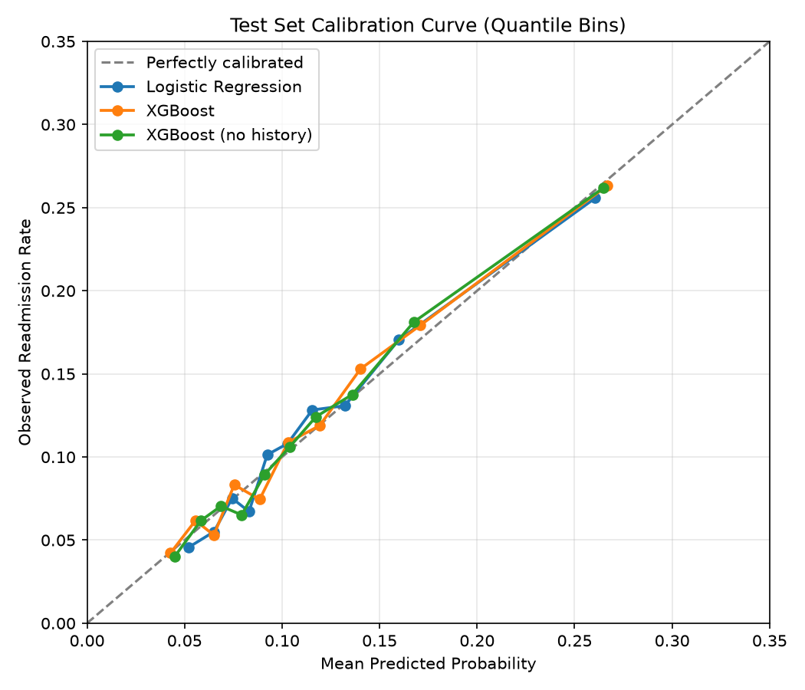
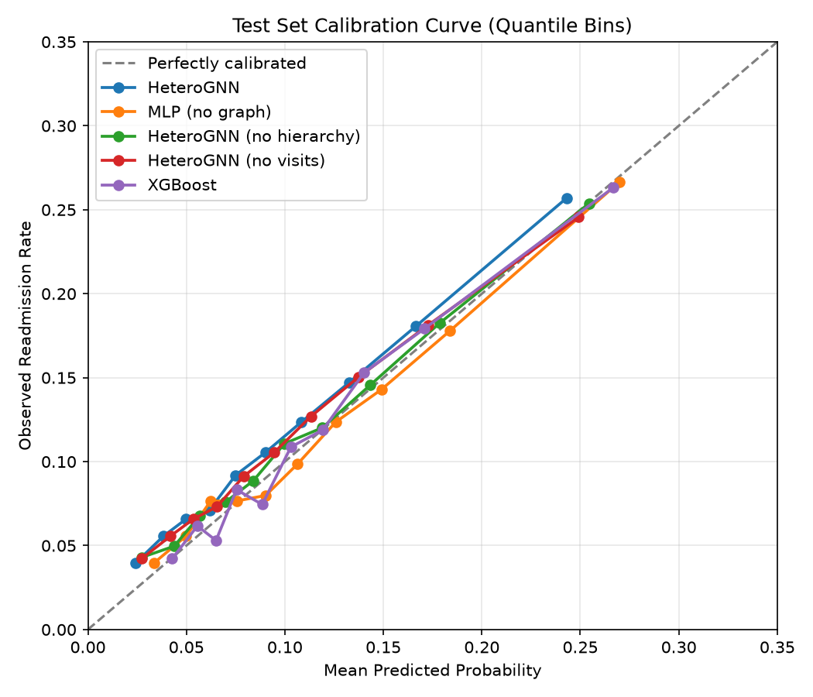
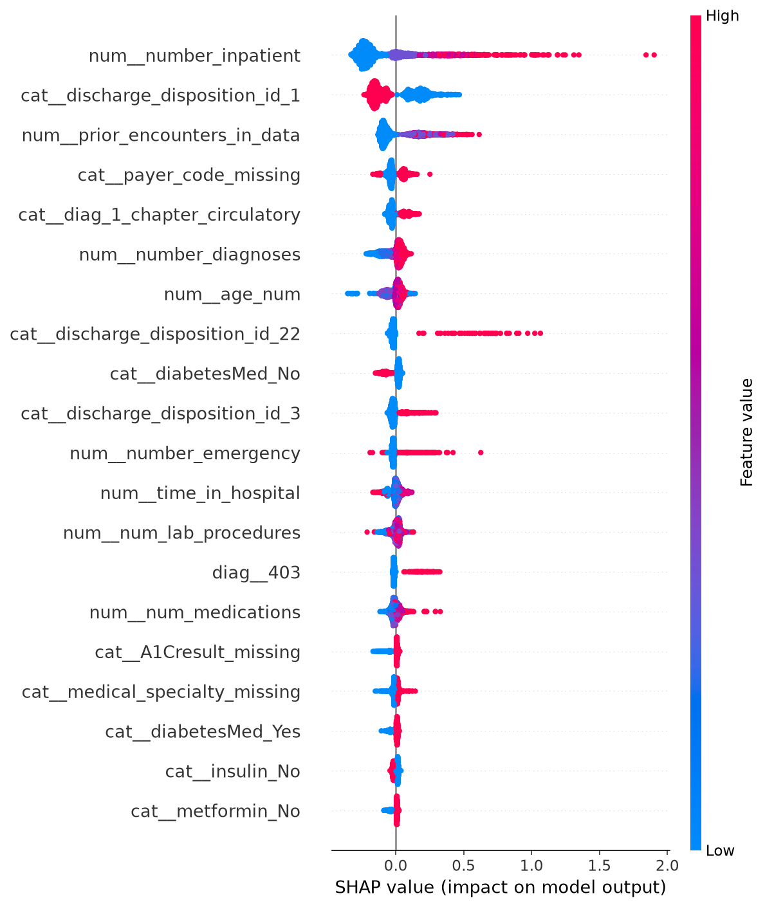

# ReadmitAI

**Relational deep learning for 30-day hospital readmission: when does graph structure beat flat-table models on real EHR data?**

ReadmitAI compares strong flat-table models (logistic regression, XGBoost) against a heterogeneous graph neural network that connects hospital visits, ICD-9 diagnosis codes, the ICD-9 hierarchy, medications and each patient's earlier visits. An MLP trained on exactly the same features isolates what the graph itself contributes. It is built on the [Diabetes 130-US Hospitals](https://archive.ics.uci.edu/dataset/296/diabetes+130-us+hospitals+for+years+1999-2008) dataset: about 100,000 real, de-identified inpatient encounters from 130 US hospitals (1999–2008).

The project is built around **leakage-free evaluation**: patient-level splits, a strict past-only rule for graph edges, paired bootstrap comparisons, calibration and subgroup reporting.

**Result in one line:** on this dataset the graph does not help. The GNN matches the MLP on AUROC and is worse on AUPRC, XGBoost stays best, and only past-visit edges add a small gain that one engineered column already captures.

📄 **Research note:** [`docs/research_note.md`](docs/research_note.md)


---

## Research Question

Does modelling the relational structure of EHR data improve 30-day readmission prediction over strong flat-table baselines? Two specific hypotheses:

1. **Hierarchy:** sharing information through the ICD-9 hierarchy helps encounters whose diagnoses are rare in training.
2. **History:** edges from a patient's earlier visits add information a single row does not.

---

## Results

Test set: 14,898 encounters from 10,522 patients never seen in training. 95% CIs come from a patient-level cluster bootstrap (1,000 resamples). Neural models: 5 seeds, predictions averaged; GNN and MLP tuned on the same 8-configuration grid.

| Model | AUROC (95% CI) | AUPRC (95% CI) | Brier | AUROC, rare codes¹ | AUROC, common codes² |
|---|---|---|---|---|---|
| Logistic regression | 0.661 (0.644–0.677) | 0.209 (0.187–0.234) | 0.0971 | 0.686 | 0.658 |
| XGBoost (no history feature) | 0.671 (0.655–0.687) | 0.223 (0.200–0.249) | 0.0962 | 0.703 | 0.670 |
| **XGBoost** | **0.676 (0.660–0.692)** | **0.226 (0.205–0.251)** | **0.0960** | 0.701 | 0.669 |
| MLP (same features as GNN, no graph) | 0.672 (0.657–0.688) | 0.219 (0.198–0.244) | 0.0963 | 0.710 | 0.665 |
| Hetero-GNN (full graph) | 0.672 (0.656–0.687) | 0.208 (0.186–0.236) | 0.0969 | 0.681 | 0.665 |
| Hetero-GNN without ICD hierarchy | 0.670 (0.655–0.686) | 0.204 (0.184–0.230) | 0.0969 | 0.688 | 0.663 |
| Hetero-GNN without past-visit edges | 0.668 (0.652–0.683) | 0.205 (0.184–0.230) | 0.0970 | 0.680 | 0.659 |
| *Random / prevalence-only* | *0.5* | *0.114* | *0.1008* | | |

¹ Encounters whose rarest diagnosis category appears fewer than 20 times in train (591 encounters, 63 positives, so wide uncertainty).
² Rarest diagnosis category appears more than 1,000 times in train (5,539 encounters).

**Paired differences** (same bootstrap resamples for both models; bold = CI excludes 0)

| Comparison | ΔAUROC (95% CI) | ΔAUPRC (95% CI) |
|---|---|---|
| XGBoost − logistic regression | **+0.015 (+0.009, +0.022)** | **+0.017 (+0.009, +0.028)** |
| XGBoost − XGBoost without history | **+0.005 (+0.001, +0.009)** | +0.003 (−0.002, +0.008) |
| Hetero-GNN − MLP | −0.001 (−0.007, +0.005) | **−0.011 (−0.020, −0.003)** |
| Hetero-GNN − XGBoost | −0.004 (−0.011, +0.002) | **−0.018 (−0.028, −0.009)** |
| Hetero-GNN − no hierarchy | +0.001 (−0.001, +0.003) | **+0.004 (+0.001, +0.007)** |
| Hetero-GNN − no past visits | **+0.004 (+0.002, +0.006)** | +0.003 (−0.001, +0.007) |

**Findings**
- **The graph does not help.** With identical features and tuning, the GNN ranks no better than the MLP and is worse on AUPRC and Brier.
- **XGBoost is the best model.** It beats logistic regression and, on AUPRC, the GNN.
- **Hierarchy hypothesis: not supported.** Flat models do not degrade on rare-diagnosis encounters, and removing the ICD-9 hierarchy does not change the GNN's ranking.
- **History hypothesis: weakly supported.** Past-visit edges add +0.004 AUROC, the same size as the flat past-only history feature (+0.005).
- **Why:** the signal sits in per-encounter utilisation features (top SHAP features: prior-year inpatient visits, discharge destination, earlier encounters in the data). Diagnosis codes carry little signal, and only about a quarter of patients have more than one encounter.
- **Robustness:**
  - Neural results barely move across tuning configurations (spread ≤ 0.003 validation AUROC).
  - No run hit its epoch limit.
  - All models are well calibrated without class weighting.
- AUPRC's random baseline is the positive rate (about 0.114), not 0.5.

| XGBoost calibration | GNN / MLP calibration | XGBoost SHAP |
|---|---|---|
|  |  |  |

---

## Architecture

```
diabetic_data.csv (101,766 encounters)
    |
    v
Ingest (ingest/diabetes130.py)
    |-- missing values ("?"), drop deaths/hospice, label = readmitted "<30"
    |-- 70/15/15 split BY PATIENT (no patient in two splits)       -> 99,340 encounters, 69,987 patients
    |
    +--------------------------------+
    v                                v
Flat features (features/tabular.py)  Heterogeneous graph (features/graph.py)
    |-- demographics, counts         |-- code -> encounter (primary / secondary diagnosis)
    |-- multi-hot ICD-9 codes        |-- code <-> ICD category <-> chapter
    |-- medications, labs            |-- medication -> encounter
    |-- past-only visit history      |-- earlier encounter -> later encounter (same patient)
    v                                v
Logistic regression, XGBoost     Hetero-GraphSAGE (3 layers) + MLP control (models/)
    |                                |
    +---------------+----------------+
                    v
Evaluation (eval/metrics.py)
    |-- AUROC, AUPRC, Brier, calibration, patient-level bootstrap CIs
    |-- paired bootstrap differences between models
    |-- subgroup AUROC (race, sex, age), rare vs common diagnosis codes
    |-- SHAP (XGBoost), ablations (GNN without hierarchy / past-visit edges)
```

**Leakage controls**
- **Patient-level split:** about 17k patients have several encounters. An encounter-level split would let a model recognise patients instead of learning risk.
- **Train-only fitting:** every transformer (scaling, one-hot encoding, code vocabulary) is fit on training rows only.
- **Deaths and hospice removed:** they cannot be readmitted and would be trivially easy negatives.
- **Past-only edges:** the dataset has no dates, but `encounter_id` order was validated as a time proxy during EDA. An encounter only receives information from *earlier* encounters of the same patient.
- **One-way vocabulary edges:** code, category, chapter and medication nodes never receive messages from encounters, so they cannot carry one patient's future back to their past.
- **No patient node:** a patient node linked to all visits would leak the future, because having a later visit is itself a readmission signal. For the same reason the graph is never made undirected.
- **Checked by assertions:** the build script fails if any edge goes from an encounter into a vocabulary node, or if a visit edge points backward in time or crosses splits.

---

## Reproduce

```bash
conda create -n readmitai -c conda-forge python=3.12 xgboost pytorch -y
conda activate readmitai
pip install -r requirements.txt
```

Download the dataset from [UCI](https://archive.ics.uci.edu/dataset/296/diabetes+130-us+hospitals+for+years+1999-2008) and unzip it so that `data/raw/diabetes130/diabetic_data.csv` exists. Then run from the project root:

```bash
python -m ingest.diabetes130   # clean, label, patient-level split -> data/processed/d130_clean.parquet
python -m models.baselines     # LR + XGBoost, SHAP, calibration      -> results/baselines/
python -m features.graph       # leakage-free heterogeneous graph      -> data/processed/d130_graph.pt
python -m models.train_gnn     # tuning, 5 seeds, ablations, paired comparisons -> results/gnn/  (~45 min on CPU)
```

Seeds are fixed: 42 for the split and flat models, 42–46 for the neural models. Each script prints its integrity checks. The EDA, including the time-proxy validation, is in `notebooks/02_eda_diabetes130.ipynb`.

---

## Tech Stack

| Layer | Choice | Why |
|---|---|---|
| Dataset | Diabetes 130-US Hospitals (UCI) | Real, open, built-in 30-day readmission label, repeat patients and diagnosis codes |
| Split | `StratifiedGroupKFold` by patient | Prevents patient-identity leakage while keeping label balance |
| Baselines | Logistic regression, XGBoost | Interpretable floor and the strongest standard tabular model |
| Graph | PyTorch Geometric `HeteroData` | Typed nodes and edges for visits, codes, hierarchy and drugs |
| GNN | Heterogeneous GraphSAGE + MLP control | Separate weights per relation type; the MLP isolates the graph's contribution |
| Interpretability | SHAP (native XGBoost contributions) | Global and per-patient explanations for the tabular model |
| Evaluation | AUROC, AUPRC, Brier, cluster and paired bootstrap, subgroups | Honest reporting on imbalanced clinical data |

---

## Repository Structure

```
readmitai/
  ingest/      diabetes130.py     cleaning, label, patient-level split
  features/    tabular.py         flat feature matrix (fit on train only)
               icd9.py            ICD-9 code -> category -> chapter mapping
               graph.py           heterogeneous graph construction + leakage assertions
  models/      baselines.py       logistic regression + XGBoost (+ no-history ablation)
               gnn.py             heterogeneous GNN + MLP control
               train_gnn.py       tuning, multi-seed training, ablations, paired comparisons
  eval/        metrics.py         metrics, bootstrap CIs, paired differences, subgroups, rare codes, SHAP, calibration
  notebooks/   02_eda_diabetes130.ipynb
  results/     baselines/  gnn/   metrics (JSON) and figures
  docs/        research_note.md
  data/        raw/ processed/    (not committed)
```

---

## Limitations

- No timestamps: visit order uses `encounter_id` as a proxy, and a true temporal split is not possible.
- One hospital network, 1999–2008, diabetic inpatients only. Results may not transfer to other populations.
- Limited relational content: at most three diagnoses per visit; no procedures, lab values, clinical notes or transfers.
- One graph architecture (GraphSAGE).
- Research project only. **Not for clinical use.**

## Next Steps

- Port the pipeline to **MIMIC-IV** (real timestamps, labs, procedures, discharge notes), where denser relational structure gives the graph a real chance to help, and a temporal split is possible.
- Attention-based message passing (GAT, relational transformers) to show which relations the model uses.

---

## Data Citation

Strack, B. et al. (2014). *Impact of HbA1c Measurement on Hospital Readmission Rates: Analysis of 70,000 Clinical Database Patient Records.* BioMed Research International. Dataset: UCI Machine Learning Repository, id 296.

## License

[MIT](LICENSE)
